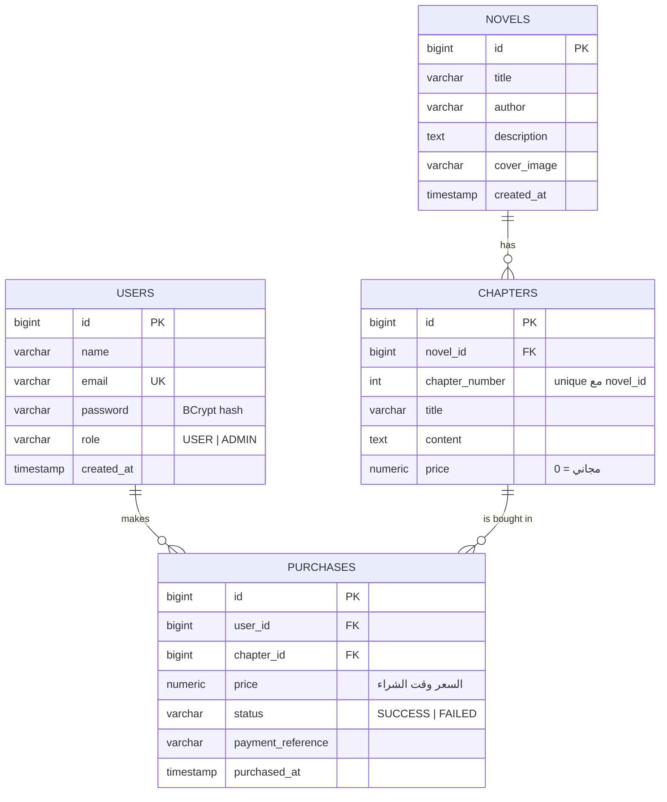

# NovelHub Backend — Spring Boot + PostgreSQL

الـ Backend (الـ API) لمنصة روايات تعليمية. مشروع مستقل تمامًا عن الـ Frontend (موجود في مجلد `novelhub-frontend` منفصل).

> شرح المفاهيم (Controller / Service / Repository / JPA / JWT / Spring Security) في **[docs/LEARNING_GUIDE.md](docs/LEARNING_GUIDE.md)**.

---

## البداية السريعة (من الصفر)

محتاج **3 حاجات فقط**:

| الحاجة | ليه؟ | تعملها إزاي |
|---|---|---|
| **JDK 21** (أو 17 أو أحدث) | عشان تشغل أي برنامج Java | الخطوة 1 |
| **PostgreSQL** | قاعدة البيانات | الخطوة 2 |
| **Maven** | ❌ **مش محتاج تثبته** | المشروع فيه `mvnw` بينزله لوحده |

### يعني إيه Maven؟ (بتشبيه npm)

- **Maven** هو أداة الـ build وإدارة المكتبات في Java، زي **npm** بالظبط.
- ملف **`pom.xml`** = زي **`package.json`**: فيه أسماء المكتبات المطلوبة (Spring, PostgreSQL driver, JWT ...).
- أمر `mvn spring-boot:run` = زي `npm run dev`: بينزل المكتبات ويشغل المشروع.
- **`mvnw`** (Maven Wrapper) = زي `npx`: سكريبت صغير جوه المشروع بينزل النسخة الصح من Maven أول مرة لوحده. عشان كده **مش هتثبت Maven أبدًا**، هتشغل `mvnw` بس.

---

### الخطوة 1: تثبيت JDK

**Windows (أسهل طريقة):** افتح PowerShell أو CMD واكتب:

```bash
winget install EclipseAdoptium.Temurin.21.JDK
```

أو نزّل الـ installer من موقع **Adoptium (Temurin 21 LTS)** — ملف `.msi` للـ Windows — واختار في الـ installer الخيارين:
**"Add to PATH"** و **"Set JAVA_HOME variable"**.

(Mac: `brew install --cask temurin@21`)

بعد التثبيت **اقفل أي CMD مفتوح وافتح واحد جديد**، واكتب:

```bash
java -version
```

لازم يظهر رقم 21 (أو 17 وأكتر). لو قال `'java' is not recognized` يبقى الـ PATH متضبطش، أعد التثبيت مع الخيارين فوق.

---

### الخطوة 2: قاعدة البيانات PostgreSQL

اختار **طريقة واحدة**:

#### الطريقة A: Docker (أسرع، لو عندك Docker Desktop)

من جوه مجلد `novelhub-backend`:

```bash
docker compose up -d
```

كده اتعملت قاعدة البيانات **`novelhub`** أوتوماتيك. اضبط `DB_PASSWORD` بنفس قيمة `POSTGRES_PASSWORD` عند التشغيل.

- تتأكد إنها شغالة: `docker ps` (لازم تشوف `novelhub-postgres`)
- توقفها: `docker compose down` (الداتا بتفضل موجودة)
- تمسح كل الداتا وتبدأ من الأول: `docker compose down -v`

#### الطريقة B: تثبيت PostgreSQL على الجهاز

1. نزّل الـ installer من **postgresql.org/download/windows** وثبته (Next ... Next).
2. هيطلب منك **Password** لليوزر `postgres`: **اكتبه واحفظه** (هتحتاجه بعد شوية).
3. سيب الـ Port `5432` زي ما هو. (في آخر التثبيت تقدر تقفل نافذة Stack Builder.)
4. افتح **pgAdmin 4** (بيتثبت معاه)، واكتب الباسورد بتاعك عشان يتصل بالسيرفر.
5. كليك يمين على **Databases** ← **Create** ← **Database...**
6. في خانة **Database** اكتب: `novelhub` ← **Save**.

خلاص! (بديل بدون pgAdmin: افتح **SQL Shell (psql)** من قائمة Start، اضغط Enter على الأسئلة الأولى، اكتب الباسورد، ثم `CREATE DATABASE novelhub;`)

> ⚠️ **مش هتعمل أي جداول بإيدك.** أنت بتعمل الـ database الفاضية بس (`novelhub`). الجداول (`users`, `novels`, `chapters`, `purchases`) الـ Backend بيعملها لوحده أول ما يشتغل، من الـ Entities، بفضل `ddl-auto: update`.

---

### الخطوة 3: ربط الـ Backend بالـ Database (كل الحكاية 3 سطور)

افتح الملف: **`src/main/resources/application.yml`** وشوف الجزء ده:

```yaml
spring:
  datasource:
    url: ${DB_URL:jdbc:postgresql://localhost:5432/novelhub}
    username: ${DB_USERNAME:postgres}
    password: ${DB_PASSWORD:change_me}
```

| السطر | معناه |
|---|---|
| `url` | عنوان الـ DB: `jdbc:postgresql://` + **السيرفر** `localhost` + **البورت** `5432` + **اسم الـ Database** `novelhub` |
| `username` | يوزر PostgreSQL (الافتراضي `postgres`) |
| `password` | الباسورد اللي اخترته وقت التثبيت |

الصيغة `${DB_PASSWORD:change_me}` معناها: "خد القيمة من متغير بيئة اسمه `DB_PASSWORD`، ولو مش موجود استخدم **اللي بعد النقطتين**". استخدم قيمة محلية خاصة بك:

```yaml
    password: ${DB_PASSWORD:<your_password>}
```

- لو استخدمت **Docker (الطريقة A)**: **متغيرش حاجة**.
- لو استخدمت **الطريقة B**: غيّر الباسورد بس (ولو اسم الـ DB أو البورت مختلفين غيّرهم في الـ `url`).

**إزاي Spring بيتصل فعليًا؟** مكتبة `postgresql` (JDBC driver) الموجودة في `pom.xml` + الـ 3 سطور دول، وSpring Boot بيفتح مجموعة اتصالات جاهزة (Connection Pool اسمه HikariCP) ويربط Hibernate بيها. مفيش كود اتصال تكتبه بنفسك.

---

### الخطوة 4: تشغيل الـ Backend

افتح CMD/PowerShell **جوه مجلد `novelhub-backend`** (المجلد اللي فيه `pom.xml`):

```bash
# Windows CMD
mvnw spring-boot:run

# Windows PowerShell
.\mvnw.cmd spring-boot:run

# Mac / Linux
./mvnw spring-boot:run
```

- **أول مرة** هياخد كام دقيقة: بينزل Maven + المكتبات (لازم إنترنت). المرات الجاية أسرع كتير.
- علامة النجاح في الـ Console:
  ```
  Created ADMIN user 'admin@novelhub.local' ...
  Inserted demo novel 'The Lighthouse Ledger'
  Started NovelHubApplication in 6.2 seconds
  ```
- جرّب في المتصفح: **http://localhost:8080/api/novels** ← لازم يظهر JSON فيه الرواية التجريبية.
- للإيقاف: `Ctrl + C`.

**حساب الأدمن:** يتم إنشاؤه باستخدام `ADMIN_EMAIL` و`ADMIN_PASSWORD` التي تضبطها محليًا.

### الخطوة 5: تتأكد إن الجداول اتعملت

في **pgAdmin**: `Servers` ← `PostgreSQL` ← `Databases` ← `novelhub` ← `Schemas` ← `public` ← `Tables`.
لازم تلاقي: `users`, `novels`, `chapters`, `purchases`. كليك يمين على جدول ← **View/Edit Data** ← **All Rows**.

(لو Docker: `docker exec -it novelhub-postgres psql -U postgres -d novelhub -c "\dt"`)

### بديل: IntelliJ IDEA (اختياري)

لو عايز IDE: نزّل **IntelliJ IDEA Community**، افتح مجلد `novelhub-backend` (هيتعرف على `pom.xml` كمشروع Maven)، وهو **بينزل JDK بنفسه** (`File ← Project Structure ← SDK ← Download JDK`) وفيه Maven جاهز. بعدها Run على `NovelHubApplication`.

---

## أخطاء شائعة وحلها

| الرسالة | السبب والحل |
|---|---|
| `'mvnw' is not recognized` | أنت مش جوه مجلد `novelhub-backend`. اعمل `cd` للمجلد اللي فيه `pom.xml` |
| `'java' is not recognized` / `JAVA_HOME ... not defined correctly` | JDK مش متثبت صح. أعد تثبيته مع "Add to PATH" و"Set JAVA_HOME"، وافتح CMD جديد |
| `password authentication failed for user "postgres"` | الباسورد في `application.yml` غير الباسورد اللي اخترته وقت تثبيت PostgreSQL |
| `Connection to localhost:5432 refused` | PostgreSQL مش شغال. الطريقة B: Windows Services ← `postgresql-x64-16` ← Start. الطريقة A: `docker compose up -d` |
| `database "novelhub" does not exist` | لازم تعمل الـ Database الفاضية `novelhub` (الخطوة 2) |
| `Port 8080 was already in use` | برنامج تاني بيستخدم 8080. اقفله أو غيّر `server.port` في `application.yml` |
| `bind: address already in use` (5432) مع Docker | عندك PostgreSQL متثبت وشغال على نفس البورت. استخدمه (الطريقة B) أو أوقفه |
| `UnsupportedClassVersionError` / `release version 17 not supported` | نسخة Java قديمة. محتاج 17 أو أحدث |
| فشل تحميل Maven أو المكتبات | مشكلة إنترنت أو Proxy/VPN. جرّب شبكة تانية وأعد التشغيل |
| `WeakKeyException` | `JWT_SECRET` أقل من 32 حرف |
| CORS error في المتصفح | `CORS_ALLOWED_ORIGINS` لازم يطابق عنوان الـ Frontend بالظبط (`http://localhost:5173`) |

---

## إعدادات اختيارية (متغيرات بيئة)

كلها ليها قيم افتراضية للتطوير في `application.yml`:

| المتغير | الافتراضي | ملاحظة |
|---|---|---|
| `DB_URL` / `DB_USERNAME` / `DB_PASSWORD` | `localhost:5432/novelhub` / `postgres` / `<your_password>` | بيانات الاتصال بالـ DB |
| `JWT_SECRET` | قيمة تطويرية | **غيّرها في أي بيئة حقيقية** (32 حرف على الأقل) |
| `CORS_ALLOWED_ORIGINS` | `http://localhost:5173` | عنوان الـ Frontend |
| `ADMIN_EMAIL` / `ADMIN_PASSWORD` / `ADMIN_NAME` | `admin@novelhub.local` / `<your_admin_password>` / `Admin` | حساب الأدمن الأول |
| `SEED_DEMO_DATA` | `true` | ضعها `false` لتعطيل الرواية التجريبية |

---

## Project Overview


**المستخدم (USER)** يقدر:
- ينشئ حساب ويسجل دخول.
- يتصفح الروايات ويفتح صفحة الرواية ويشوف الفصول وأسعارها.
- يشتري فصل بـ Mock Payment، وبعدها يقرأه.
- يشوف كل ما اشتراه في **My Library**.

**الأدمن (ADMIN)** يقدر:
- إضافة / تعديل / حذف الروايات.
- إضافة / تعديل / حذف الفصول (العنوان، المحتوى، السعر).
- مشاهدة المستخدمين والمشتريات.

**أهم قاعدة في المشروع:** محتوى الفصل المدفوع لا يخرج من الـ Backend إلا إذا كان للمستخدم `Purchase` بحالة `SUCCESS` على هذا الفصل. الحماية في الـ Backend وليس في الـ Frontend.

---

## Technologies

| الطبقة | التقنيات |
|---|---|
| Backend | Java 17+, Spring Boot 3.5, Spring Web (REST), Spring Security + JWT (jjwt), Spring Data JPA / Hibernate, Bean Validation, Maven (Wrapper) |
| Database | PostgreSQL 16 |

الـ Frontend (React + Vite + Tailwind) في مشروع منفصل: `novelhub-frontend`.

---

## Project Structure

```
novelhub-backend/
├── pom.xml                         # المكتبات (زي package.json)
├── mvnw / mvnw.cmd                 # Maven Wrapper: بيشغل Maven من غير تثبيت
├── docker-compose.yml              # PostgreSQL جاهز (اختياري)
├── docs/LEARNING_GUIDE.md          # الشرح التعليمي
└── src/main/
    ├── resources/application.yml   # إعدادات الـ DB و JWT و CORS
    └── java/com/novelhub/
        ├── NovelHubApplication.java
        ├── config/        SecurityConfig, DataInitializer (ينشئ الأدمن + رواية تجريبية)
        ├── security/      JwtService, JwtAuthFilter, UserPrincipal, CustomUserDetailsService, RestSecurityExceptionHandler
        ├── entity/        User, Novel, Chapter, Purchase, Role, PurchaseStatus
        ├── repository/    UserRepository, NovelRepository, ChapterRepository, PurchaseRepository
        ├── dto/           Request / Response records (لا نرجع الـ Entities مباشرة)
        ├── service/       AuthService, NovelService, ChapterService, PurchaseService, UserService
        │   └── payment/   PaymentService (interface) + MockPaymentService
        ├── controller/    AuthController, NovelController, ChapterController, PurchaseController, AdminController
        └── exception/     GlobalExceptionHandler + exceptions مخصصة
```

---

## Database Relations




- `Novel 1 ── * Chapter` : `@OneToMany` في Novel و `@ManyToOne` في Chapter (الـ Foreign Key `novel_id` في جدول chapters).
- `User 1 ── * Purchase` و `Chapter 1 ── * Purchase` : `Purchase` هو الجدول الوسيط بين المستخدمين والفصول، وله بيانات إضافية (السعر، الحالة، التاريخ).
- الجداول تُنشأ تلقائيًا (`ddl-auto: update`).

---

## API Endpoints


| Method | Path | الصلاحية | الوصف |
|---|---|---|---|
| POST | `/api/auth/register` | عام | إنشاء حساب (Role = USER دائمًا) + يرجع JWT |
| POST | `/api/auth/login` | عام | تسجيل دخول + يرجع JWT |
| GET | `/api/auth/me` | مسجل دخول | بيانات المستخدم الحالي |
| GET | `/api/novels` | عام | قائمة الروايات |
| GET | `/api/novels/{id}` | عام | الرواية + قائمة الفصول (بدون محتوى) + `unlocked` لكل فصل |
| GET | `/api/chapters/{id}` | مسجل دخول | **محتوى الفصل**: 200 إذا مجاني/مشترى/أدمن، وإلا **403** `CHAPTER_LOCKED` |
| POST | `/api/purchases/{chapterId}` | مسجل دخول | شراء فصل (Mock Payment) |
| GET | `/api/purchases/my` | مسجل دخول | My Library |
| POST | `/api/admin/novels` | ADMIN | إضافة رواية |
| PUT | `/api/admin/novels/{id}` | ADMIN | تعديل رواية |
| DELETE | `/api/admin/novels/{id}` | ADMIN | حذف رواية (مع فصولها ومشترياتها) |
| GET | `/api/admin/novels/{novelId}/chapters` | ADMIN | فصول الرواية مع المحتوى |
| POST | `/api/admin/novels/{novelId}/chapters` | ADMIN | إضافة فصل |
| PUT | `/api/admin/chapters/{id}` | ADMIN | تعديل فصل (العنوان/المحتوى/السعر/الرقم) |
| DELETE | `/api/admin/chapters/{id}` | ADMIN | حذف فصل |
| GET | `/api/admin/users` | ADMIN | المستخدمون |
| GET | `/api/admin/purchases` | ADMIN | كل المشتريات |

**شكل الأخطاء (موحد):**
```json
{ "timestamp": "...", "status": 403, "code": "CHAPTER_LOCKED", "message": "You need to purchase this chapter to read it", "fieldErrors": null }
```
الأكواد: `VALIDATION_FAILED` (400) · `INVALID_CREDENTIALS` / `UNAUTHORIZED` (401) · `FORBIDDEN` / `CHAPTER_LOCKED` (403) · `NOT_FOUND` (404) · `CONFLICT` (409).

---

## كيفية إنشاء Admin User


التسجيل العام ينشئ **USER فقط** (حتى لا يستطيع أحد تسجيل نفسه كأدمن). ثلاث طرق للأدمن:

1. **تلقائي (الافتراضي):** `DataInitializer` ينشئ أدمن عند التشغيل من `ADMIN_EMAIL` و `ADMIN_PASSWORD`.
   بيانات الدخول: القيم التي ضبطتها في `ADMIN_EMAIL` و`ADMIN_PASSWORD`.
2. **ترقية مستخدم موجود بـ SQL:** سجّل حسابًا عاديًا من الواجهة ثم:
   ```sql
   UPDATE users SET role = 'ADMIN' WHERE email = 'you@example.com';
   ```
   (سجل الدخول مرة أخرى بعدها، أو حدّث الصفحة.)
3. غيّر متغيرات `ADMIN_*` قبل أول تشغيل.

---

## شرح مختصر لتدفق النظام


```
React (Axios)                    Spring Boot                                   PostgreSQL
─────────────                    ───────────                                   ──────────
POST /auth/login  ─────────────► AuthController → AuthService
                                  AuthenticationManager يفحص الباسورد (BCrypt)  ──► users
                  ◄───────────── JWT { sub: email, exp } موقّع بالـ secret
(يحفظ الـ token)

GET /chapters/5
Authorization: Bearer <JWT> ───► JwtAuthFilter: يتحقق من التوقيع والانتهاء
                                  ← يضع المستخدم في SecurityContext
                                  SecurityConfig: الرابط يحتاج تسجيل دخول ✔
                                  ChapterController → ChapterService.read()
                                    الفصل مجاني؟ ─ نعم ─► يرجع المحتوى
                                    الأدمن؟ ─ نعم ────────► يرجع المحتوى
                                    Purchase SUCCESS موجود؟ ──────────────────► purchases
                                       نعم ► 200 + المحتوى
                                       لا  ► 403 CHAPTER_LOCKED (بدون محتوى)

POST /purchases/5 ─────────────► PurchaseService.purchase()
                                    الفصل مدفوع؟ لم يُشتر من قبل؟
                                    PaymentService.charge()  (Mock الآن)
                                    INSERT Purchase(SUCCESS) ─────────────────► purchases
```

---

## جرّب الحماية بنفسك (curl)


```bash
# 1) تسجيل الدخول كأدمن
curl -s -X POST localhost:8080/api/auth/login -H "Content-Type: application/json" \
  -d '{"email":"admin@novelhub.local","password":"<your_admin_password>"}'

# 2) بدون token => 401
curl -i localhost:8080/api/chapters/2

# 3) سجّل مستخدمًا عاديًا ثم خذ الـ token
curl -s -X POST localhost:8080/api/auth/register -H "Content-Type: application/json" \
  -d '{"name":"Sara","email":"sara@example.com","password":"secret123"}'

# 4) فصل مدفوع بدون شراء => 403 CHAPTER_LOCKED (لا يوجد content في الرد)
curl -i localhost:8080/api/chapters/2 -H "Authorization: Bearer USER_TOKEN"

# 5) شراء الفصل ثم قراءته => 200
curl -X POST localhost:8080/api/purchases/2 -H "Authorization: Bearer USER_TOKEN"
curl localhost:8080/api/chapters/2 -H "Authorization: Bearer USER_TOKEN"

# 6) USER يحاول الوصول لـ Admin API => 403
curl -i localhost:8080/api/admin/users -H "Authorization: Bearer USER_TOKEN"
```
(أرقام الفصول تعتمد على الـ ids في قاعدتك؛ شوفها من `GET /api/novels/1`.)

---

## حدود معروفة (مقصودة للتبسيط) وأفكار للتطوير


هذه نقاط تستحق تفكيرك لأنها ما يفرق مشروع تعليمي عن Production:

- **Migrations:** `ddl-auto: update` مناسب للتعلم فقط؛ استخدم Flyway أو Liquibase.
- **شراء مزدوج:** لو ضغط المستخدم "Buy" مرتين بنفس اللحظة قد ينشأ سجلان `SUCCESS`. الحل: Unique constraint جزئي (`WHERE status = 'SUCCESS'`) أو Idempotency key.
- **حذف فصل/رواية** يحذف سجلات الشراء (يفقد التاريخ المالي). في منتج حقيقي: Soft delete / Archive.
- **JWT في localStorage** عرضة لـ XSS؛ البديل httpOnly cookie + CSRF protection. وأضف Refresh Tokens.
- **Rate limiting** على `/login` لمنع تخمين الباسورد.
- **بوابة دفع حقيقية:** أضف `StripePaymentService` + حالة `PENDING` + Webhook.
- **Tests:** ابدأ بـ `@SpringBootTest` + `MockMvc` لاختبار: (مستخدم بدون شراء يحصل 403)، (USER على `/api/admin` يحصل 403).
- **Pagination** لقائمة الروايات والمشتريات، وبحث بالعنوان.
- **رفع صور الأغلفة** (الآن نخزن رابطًا فقط).
